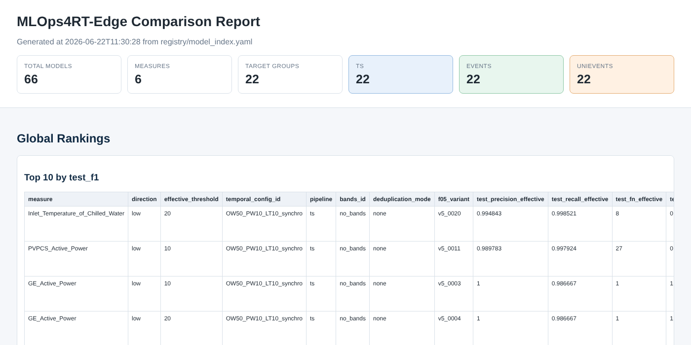
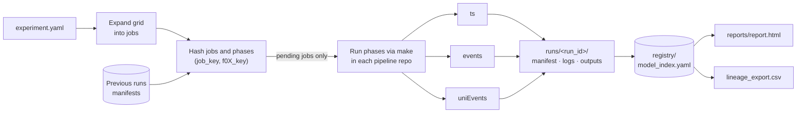

# MLOps4RT-Edge Comparisons

<<<<<<< HEAD
Repositorio **orquestador**. No contiene modelos, datasets pesados, dashboards ni base de datos: solo lee `experiment.yaml`, lanza variantes en pipelines MLOps que ya existen en otros repos, y guarda trazabilidad ligera (manifests, logs y una copia pequeña de outputs) en `runs/`.

Compara tres pipelines equivalentes:

- **`ts`**: pipeline de series temporales.
- **`events`**: pipeline de ventanas de eventos.
- **`uniEvents`**: pipeline de eventos univariante por medida.

Si es tu primera vez en este repo, lee primero [Guía rápida](#guía-rápida-primeros-pasos) y luego consulta el resto de secciones según lo necesites.

## Índice

- [Guía rápida (primeros pasos)](#guía-rápida-primeros-pasos)
- [Estructura del repositorio](#estructura-del-repositorio)
- [`experiment.yaml`: cómo configurar un experimento](#experimentyaml-cómo-configurar-un-experimento)
- [`run_experiment.py`: lanzar el experimento](#run_experimentpy-lanzar-el-experimento)
- [`export_lineage_csv.py`: CSV de trazabilidad para no técnicos](#export_lineage_csvpy-csv-de-trazabilidad-para-no-técnicos)
- [Idempotencia y reintentos](#idempotencia-y-reintentos)
- [Conceptos clave](#conceptos-clave-job_key-effective_threshold-band-sets)

## Guía rápida (primeros pasos)

Flujo típico de trabajo, en orden:

```bash
# 1. Edita experiment.yaml: qué repos, qué medidas, qué bandas, qué pipelines correr
experiment.yaml

# 2. Lanza los jobs pendientes (crea una carpeta runs/YYYY-MM-DD_NNN/)
python scripts/run_experiment.py

# 3. Genera el informe HTML navegable con los resultados
python scripts/build_report.py

# 4. Ábrelo
start reports/report.html
```

Con eso ya tienes el ciclo completo: configurar -> ejecutar -> visualizar resultados. El resto del README explica cada pieza con más detalle, incluyendo cómo recolectar outputs sin relanzar nada y cómo exportar un CSV de trazabilidad para gente no técnica.

## Estructura del repositorio

```text
experiment.yaml           # configuración del experimento (el único archivo que sueles editar)
scripts/                  # todos los comandos ejecutables (ver más abajo)
runs/<run_id>/            # una carpeta por cada ejecución de run_experiment.py
  manifest.csv             #   estado (COMPLETED/FAILED/...) de cada job de ese run
  logs/                     #   stdout, stderr y comandos ejecutados por job
  outputs/                  #   copia ligera de los ficheros configurados en outputs.phases
registry/model_index.yaml # índice global acumulado de TODOS los modelos creados (todos los runs)
reports/report.html       # informe HTML generado a partir de registry/model_index.yaml
exported_params/          # exportaciones auxiliares (params sin ejecutar nada, lineage CSV, etc.)
```

Nada de esto se versiona pesado en git salvo la configuración; `runs/`, `registry/` y `reports/` son artefactos generados que puedes regenerar en cualquier momento.

## `experiment.yaml`: cómo configurar un experimento

Es el único archivo que necesitas tocar para definir qué se ejecuta. Sus secciones principales:

### `repos` y `pipelines`

Dónde viven los repos reales de cada pipeline, y cuáles están activos en esta ejecución (los que estén comentados con `#` se ignoran):
=======
**Experiment orchestrator for comparing three edge-ML pipelines.** You describe an experiment in a single YAML file; the orchestrator expands it into a grid of jobs, runs them across three MLOps pipelines, skips anything already done, and builds a model registry and an HTML report so the results can be compared side by side.



> Built during my research assistantship in the STRAST group (Dept. of Telematics Engineering, Universidad Politécnica de Madrid), 2026. The three pipelines it drives were developed by the group; **this orchestrator is entirely my work.**

## Context

The STRAST group's **MLOps4RT-Edge** project detects anomalies in electrical measurements from a microgrid and deploys the models as quantized TensorFlow Lite models on ESP32 microcontrollers. Each pipeline runs in phases (F01 explore data → F02 events → F03 windows → F04 targets → F05 train → F06 quantize → F07/F08 on-device), and every phase produces versioned *variants* with their own parameters and outputs.

There are three ways of framing the problem, each in its own repository:
>>>>>>> 5ddc31dcf05bb5106d2f7c94d4e8abfc31900c02

| Pipeline | Repository | Approach |
|---|---|---|
| `ts` | [mlops4rtedgeTS](https://github.com/iivvjj/mlops4rtedgeTS) | Time-series windows |
| `events` | `mlops4rtedge` (group repository) | Event windows across measures |
| `uniEvents` | [mlops4rtedgeUni](https://github.com/iivvjj/mlops4rtedgeUni) | Univariate events, one measure at a time |

Comparing them by hand meant launching hundreds of `make` commands with matching parameters in three repos and keeping track of which run produced which model. This repo automates that.

## What it does

- **Declarative experiments:** one `experiment.yaml` defines which pipelines, measures, thresholds, temporal windows and model settings to compare. The `grid` section is expanded as a Cartesian product into individual jobs.
- **Idempotent and resumable:** each job gets a stable hash (`job_key`) from its scientific configuration. Re-running the script never repeats a `COMPLETED` job and automatically retries `FAILED` ones.
- **Phase-level caching:** the orchestrator also hashes each phase (`f02_key` … `f05_key`) and reuses intermediate variants across jobs when they already exist, so changing a late-stage parameter does not recompute the early phases.
- **Model registry:** `registry/model_index.yaml` accumulates every model ever produced, across all runs, with its full lineage (F02 → F06 variants) and metrics.
- **HTML report:** `build_report.py` turns the registry into a browsable report with global rankings (F1, precision, recall, PR-AUC) and per-measure comparisons between the three pipelines.
- **Lineage export for non-technical readers:** `export_lineage_csv.py` writes one row per experiment in plain language, including experiments that stopped halfway, so results can be shared with people who don't know the code.
- **Dry run:** export the parameter files each job would use without running anything, to review an expensive experiment before launching it.

## How it works



<<<<<<< HEAD
### `parents`

Fija la variante F01 (dataset base) de la que cuelga cada pipeline, p. ej. `events_f01: v1_0003`. Si no defines la del pipeline concreto, el orquestador cae al valor de `events_f01` como fallback.

### `base`

Parámetros fijos que aplican a todos los jobs: familia de modelo, estrategia de desbalanceo, semillas, épocas de entrenamiento, tamaños máximos de muestra para validación/test, configuración de AutoML, etc. Cámbialos aquí cuando quieras que todos los jobs de la matriz usen el mismo valor.

### `grid`: la matriz de combinaciones

Todo lo que pongas dentro de `grid` se **cruza** (producto cartesiano) para generar los jobs a ejecutar:

- **`measures`**: lista de medidas/variables a comparar (p. ej. `ac_voltage`, `battery_voltage`, ...).
- **`directions`**: `high` y/o `low` (de qué lado del umbral se define el evento).
- **`temporal_configs`**: combinaciones de ventana temporal, cada una con un `id` único:

  ```yaml
  grid:
    temporal_configs:
      - id: ow600_lt10_pw100
        OW: 600
        LT: 10
        PW: 100
        window_strategy: synchro
        nan_mode: discard
  ```

- **`event_band_sets`**: en vez de un grid de thresholds sueltos, se definen conjuntos de bandas (`id` + lista `values` de porcentajes). El `effective_threshold` se deriva de la dirección: `high` usa la última banda, `low` usa la primera.

  ```yaml
  event_band_sets:
    - id: coarse_10
      values: [10, 20, 30, 40, 50, 60, 70, 80, 90]
  ```

  Con `direction: high` sobre ese band set, `effective_threshold` = `90`.

- **`deduplication_modes`** (opcional, default `none`): controla la deduplicación en la fase F05 (`none`, `auto`, `neg_only`, `all`). Se pasa como `DEDUP_MODE` a `make variant5` y forma parte de la identidad del modelo — cambiarlo crea una F05 nueva, pero el orquestador intenta reutilizar F02/F03/F04 si ya existen.

### `outputs`

Controla qué ficheros se copian de cada variante generada hacia `runs/<run_id>/outputs/`.


## `run_experiment.py`: lanzar el experimento

```bash
python scripts/run_experiment.py
```

Qué hace, paso a paso:

1. Lee `experiment.yaml` y lo valida.
2. Expande la matriz de `grid` en jobs individuales, para cada pipeline listado en `pipelines`.
3. Lee todos los manifests anteriores (`runs/*/manifest.csv`) para saber qué ya está `COMPLETED`.
4. Salta los jobs que ya están completados; los que estaban `FAILED` se reintentan.
5. Si hay jobs pendientes, crea una carpeta nueva `runs/YYYY-MM-DD_NNN/` (con numeración incremental si ya corriste algo ese mismo día).
6. Ejecuta los jobs pendientes uno a uno, invocando los `make` / scripts de cada repo pipeline.
7. Va guardando en tiempo real logs (`runs/<run_id>/logs/`), el manifest (`runs/<run_id>/manifest.csv`) y los outputs configurados.

Si no hay jobs nuevos que ejecutar, el script no crea carpeta y simplemente informa que todo está `COMPLETED`.

Los outputs quedan organizados así:

```text
runs/<run_id>/outputs/<pipeline>/<job_key>/f02/
runs/<run_id>/outputs/<pipeline>/<job_key>/f03/
runs/<run_id>/outputs/<pipeline>/<job_key>/f04/
runs/<run_id>/outputs/<pipeline>/<job_key>/f05/
runs/<run_id>/outputs/<pipeline>/<job_key>/f06/
```
### Modo "solo exportar" (sin ejecutar nada)

```bash
python scripts/run_experiment.py --export-params-yamls --export-dir exported_params
```

Expande la misma matriz de jobs pero, en vez de ejecutar `make`/scripts, escribe los YAML de parámetros que se usarían por cada variante/pipeline en el directorio indicado (por defecto `exported_params/`). Útil para revisar la configuración resultante antes de lanzar una ejecución real y costosa.


## `export_lineage_csv.py`: CSV de trazabilidad para no técnicos

```bash
python scripts/export_lineage_csv.py
```

Genera `exported_params/lineage_export.csv`: **una fila por experimento** (la "hoja" final de la cadena de variantes F02→F03→F04→F05→F06...) en lenguaje llano, sin rutas de disco ni códigos internos de variante — pensado para compartir con alguien que no conoce el repo ni el pipeline.

Cómo obtiene los datos, por cada uno de los 3 repos (`events`, `ts`, `uniEvents`):

- Si el repo tiene `executions/pipeline_lineage.html`, lee de ahí el registro completo de nodos (parámetros, variante padre, metadatos) — es la fuente más rica y sobrevive aunque se hayan podado los ficheros `params.yaml`/`metadata.yaml` en disco.
- Si no existe ese HTML, cae a leer directamente `executions/f0N_xxx/vN_YYYY/params.yaml` y `metadata.yaml` de cada variante.
- Las métricas (precision/recall/f1/PR-AUC/...) siempre se leen de `outputs.yaml` en disco junto a cada variante, porque ese fichero nunca se embebe en el HTML de lineage.

Una "hoja" (leaf) es cualquier variante que ningún otro nodo referencia como padre — esto captura tanto experimentos completados hasta el final (F06/F07/F08) como experimentos que se quedaron a medias (una F04 sobre la que nadie construyó F05, o una fase que falló), reflejado en las columnas `estado` y `fase_alcanzada` del CSV.

Opciones:

```bash
# Sobrescribir/añadir la ruta de un repo (repetible)
python scripts/export_lineage_csv.py --repo uniEvents=C:/otra/ruta/mlops4rtedgeUni

# Cambiar la ruta de salida
python scripts/export_lineage_csv.py --output exported_params/lineage_export_2026.csv
```

Por defecto usa las rutas de repos definidas dentro del propio script (`DEFAULT_REPOS`); si tu checkout local vive en otro sitio, usa `--repo` para apuntar a la ruta correcta.


## Idempotencia y reintentos

La identidad de cada job se calcula con un hash estable (`job_key`) derivado de su configuración científica (medida, dirección, configuración temporal, bandas, `effective_threshold`, configuración de modelo). Esto permite:

- Volver a correr `run_experiment.py` las veces que quieras: los jobs `COMPLETED` nunca se repiten.
- Reintentar automáticamente jobs que quedaron `FAILED` en una ejecución anterior.
- Reutilizar fases intermedias entre jobs: además del `job_key`, el orquestador calcula claves por fase (`f02_key`, `f03_key`, `f04_key`, `f05_key`). Al arrancar, construye una caché a partir de los manifests `COMPLETED` y solo reutiliza una fase si la variante existe físicamente en el repo original — en ese caso no vuelve a ejecutar `make scriptX`, simplemente la usa como padre de la siguiente fase. Los reintentos de jobs `FAILED` sí ejecutan `scriptX` de nuevo sobre la variante previa, para continuar o repetir esa fase.

## Conceptos clave: `job_key`, `effective_threshold`, band sets

- **`effective_threshold`**: se deriva de `direction` + el band set usado. `high` toma la última banda de `values`; `low` toma la primera. No se define directamente como un número en el grid.
- **Diferencia de `job_key` entre pipelines**:
  - En `events` y `uniEvents`, el `job_key` incluye configuración temporal, medida, dirección, `bands_id`, la lista completa de bandas, `effective_threshold` y configuración de modelo. Por eso estos dos pipelines ejecutan **un job por cada band set completo**, aunque dos band sets compartan el mismo `effective_threshold`.
  - En `ts`, el `job_key` incluye configuración temporal y `effective_threshold`, pero **no** incluye `bands_id` ni la lista completa de bandas. Por eso, si dos band sets distintos comparten el mismo `effective_threshold`, `ts` solo se ejecuta **una vez** para esa medida/dirección/configuración temporal.
- **Diferencia entre `events` y `uniEvents`** está en la fase F02: `events` genera F02 con bandas, estrategia y `nan_mode`; `uniEvents` añade además `MEASURE` a esa fase.
=======
## Quick start

**Requirements:** Python 3.11 with `pyyaml`, `pandas`, `numpy` and `scikit-learn`, plus local clones of the three pipeline repos (each with its own setup) next to this one:

```text
parent-folder/
├── mlops4rtedge-comparisons/   ← this repo
├── mlops4rtedge/
├── mlops4rtedgeTS/
└── mlops4rtedgeUni/
```

```bash
# 1. Edit the experiment: pipelines, measures, bands, temporal configs, model settings
#    (repo paths in experiment.yaml default to the sibling folders above)

# 2. Run the pending jobs (creates runs/YYYY-MM-DD_NNN/)
python scripts/run_experiment.py

# 3. Build the HTML report from the registry
python scripts/build_report.py

# Optional: preview the parameters of every job without running anything
python scripts/run_experiment.py --export-params-yamls --export-dir exported_params

# Optional: plain-language CSV of every experiment
python scripts/export_lineage_csv.py
```

## Configuring an experiment

`experiment.yaml` is the only file you normally edit:

| Section | Purpose |
|---|---|
| `repos`, `pipelines` | Where each pipeline repo lives and which ones are active in this run |
| `parents` | The base F01 dataset variant each pipeline starts from |
| `base` | Settings shared by every job: model family, class-imbalance strategy, seeds, epochs, AutoML, evaluation sample sizes |
| `grid` | The dimensions to cross: `measures`, `directions` (`high`/`low`), `temporal_configs` (window sizes and strategy), `event_band_sets` and optional `deduplication_modes` |
| `outputs` | Which files from each variant are copied into `runs/<run_id>/outputs/` |

Example of a temporal configuration and a band set:

```yaml
grid:
  temporal_configs:
    - id: ow600_lt10_pw100
      OW: 600            # observation window
      LT: 10             # lead time
      PW: 100            # prediction window
      window_strategy: synchro
      nan_mode: discard
  event_band_sets:
    - id: coarse_10
      values: [10, 20, 30, 40, 50, 60, 70, 80, 90]
```

The `effective_threshold` that defines an event comes from the direction and the band set: `high` uses the last band, `low` the first.

### A design detail: job identity differs per pipeline

- In `events` and `uniEvents`, `job_key` includes the whole band set, so two band sets with the same effective threshold are two different jobs.
- In `ts`, bands don't affect the model, so `job_key` only includes the effective threshold. Two band sets that share it run **once**, which avoids training identical models twice.

## Repository layout

```text
experiment.yaml             experiment definition
scripts/                    run_experiment, build_report, build_model_index,
                            export_lineage_csv, collect_outputs, PR-AUC backfill
runs/<run_id>/              one folder per execution: manifest.csv, logs/, outputs/
registry/model_index.yaml   global index of every model produced
reports/                    generated HTML reports
exported_params/            dry-run parameter files and lineage CSV
```

`runs/`, `registry/` and `reports/` are generated and can be rebuilt at any time; the results from my last experiments are kept here as an example.
>>>>>>> 5ddc31dcf05bb5106d2f7c94d4e8abfc31900c02
