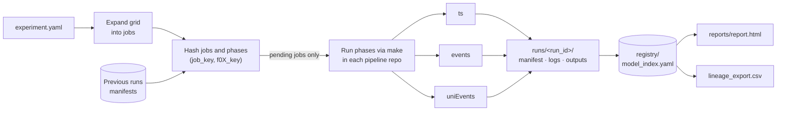

# MLOps4RT-Edge Comparisons

**Experiment orchestrator for comparing three edge-ML pipelines.** You describe an experiment in a single YAML file; the orchestrator expands it into a grid of jobs, runs them across three MLOps pipelines, skips anything already done, and builds a model registry and an HTML report so the results can be compared side by side.


> Built during my research assistantship in the STRAST group (Dept. of Telematics Engineering, Universidad Politécnica de Madrid), 2026. The three pipelines it drives were developed by the group; **this orchestrator is entirely my work.**

## Context

The STRAST group's **MLOps4RT-Edge** project detects anomalies in electrical measurements from a microgrid and deploys the models as quantized TensorFlow Lite models on ESP32 microcontrollers. Each pipeline runs in phases (F01 explore data → F02 events → F03 windows → F04 targets → F05 train → F06 quantize → F07/F08 on-device), and every phase produces versioned *variants* with their own parameters and outputs.

There are three ways of framing the problem, each in its own repository:

| Pipeline | Repository | Approach |
|---|---|---|
| `ts` | [mlops4rtedgeTS](https://github.com/iivvjj/mlops4rtedgeTS) | Time-series windows |
| `events` | `mlops4rtedge` (group repository) | Event windows across measures |
| `uniEvents` | [mlops4rtedgeUni](https://github.com/iivvjj/mlops4rtedgeUni) | Univariate events, one measure at a time |

Comparing them by hand meant launching hundreds of `make` commands with matching parameters in three repos and keeping track of which run produced which model. This repo automates that.

## What it does

- **Declarative experiments:** one `experiment.yaml` defines which pipelines, measures, thresholds, temporal windows and model settings to compare. The `grid` section is expanded as a Cartesian product into individual jobs.
- **Idempotent and resumable:** each job gets a stable hash (`job_key`) from its scientific configuration. Re-running the script never repeats a `COMPLETED` job and automatically retries `FAILED` ones.
- **Phase-level caching:** the orchestrator also hashes each phase (`f02_key` … `f05_key`) and reuses intermediate variants across jobs when they already exist, so changing a late-stage parameter does not recompute the early phases.
- **Model registry:** `registry/model_index.yaml` accumulates every model ever produced, across all runs, with its full lineage (F02 → F06 variants) and metrics.
- **HTML report:** `build_report.py` turns the registry into a browsable report with global rankings (F1, precision, recall, PR-AUC) and per-measure comparisons between the three pipelines.
- **Lineage export for non-technical readers:** `export_lineage_csv.py` writes one row per experiment in plain language, including experiments that stopped halfway, so results can be shared with people who don't know the code.
- **Dry run:** export the parameter files each job would use without running anything, to review an expensive experiment before launching it.

## How it works



## Quick start

**Requirements:** Python 3.11 with `pyyaml`, `pandas`, `numpy` and `scikit-learn`, plus local clones of the three pipeline repos (each with its own setup) next to this one:

```text
parent-folder/
├── mlops4rtedge-comparisons/   ← this repo
├── mlops4rtedge/
├── mlops4rtedgeTS/
└── mlops4rtedgeUni/
```

```bash
# 1. Edit the experiment: pipelines, measures, bands, temporal configs, model settings
#    (repo paths in experiment.yaml default to the sibling folders above)

# 2. Run the pending jobs (creates runs/YYYY-MM-DD_NNN/)
python scripts/run_experiment.py

# 3. Build the HTML report from the registry
python scripts/build_report.py

# Optional: preview the parameters of every job without running anything
python scripts/run_experiment.py --export-params-yamls --export-dir exported_params

# Optional: plain-language CSV of every experiment
python scripts/export_lineage_csv.py
```

## Configuring an experiment

`experiment.yaml` is the only file you normally edit:

| Section | Purpose |
|---|---|
| `repos`, `pipelines` | Where each pipeline repo lives and which ones are active in this run |
| `parents` | The base F01 dataset variant each pipeline starts from |
| `base` | Settings shared by every job: model family, class-imbalance strategy, seeds, epochs, AutoML, evaluation sample sizes |
| `grid` | The dimensions to cross: `measures`, `directions` (`high`/`low`), `temporal_configs` (window sizes and strategy), `event_band_sets` and optional `deduplication_modes` |
| `outputs` | Which files from each variant are copied into `runs/<run_id>/outputs/` |

Example of a temporal configuration and a band set:

```yaml
grid:
  temporal_configs:
    - id: ow600_lt10_pw100
      OW: 600            # observation window
      LT: 10             # lead time
      PW: 100            # prediction window
      window_strategy: synchro
      nan_mode: discard
  event_band_sets:
    - id: coarse_10
      values: [10, 20, 30, 40, 50, 60, 70, 80, 90]
```

The `effective_threshold` that defines an event comes from the direction and the band set: `high` uses the last band, `low` the first.

### A design detail: job identity differs per pipeline

- In `events` and `uniEvents`, `job_key` includes the whole band set, so two band sets with the same effective threshold are two different jobs.
- In `ts`, bands don't affect the model, so `job_key` only includes the effective threshold. Two band sets that share it run **once**, which avoids training identical models twice.

## Repository layout

```text
experiment.yaml             experiment definition
scripts/                    run_experiment, build_report, build_model_index,
                            export_lineage_csv, collect_outputs, PR-AUC backfill
runs/<run_id>/              one folder per execution: manifest.csv, logs/, outputs/
registry/model_index.yaml   global index of every model produced
reports/                    generated HTML reports
exported_params/            dry-run parameter files and lineage CSV
```

`runs/`, `registry/` and `reports/` are generated and can be rebuilt at any time; the results from my last experiments are kept here as an example.
